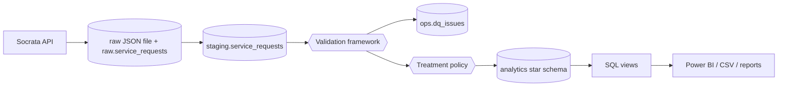
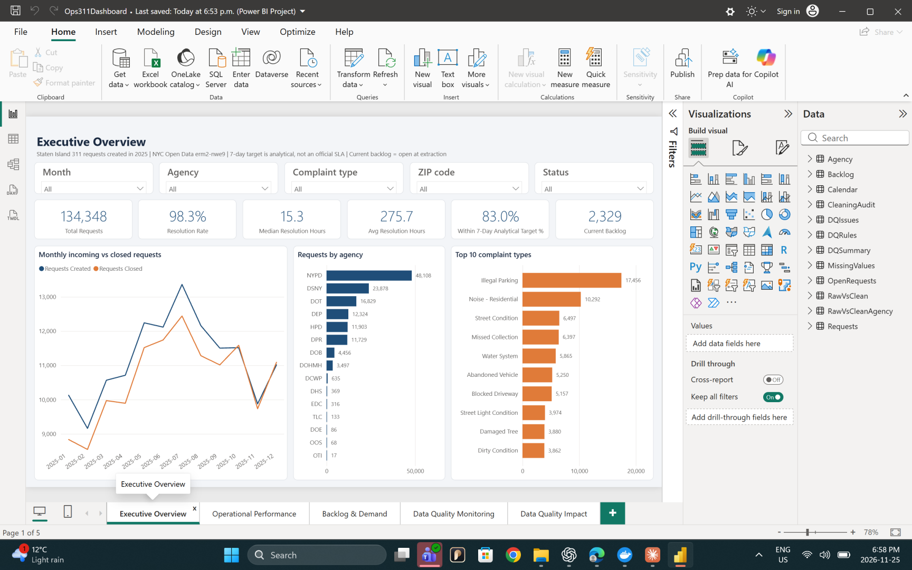

# Operations Performance & Data Quality Dashboard (NYC 311)

An end-to-end analytics project on **real municipal service request data**. It covers API extraction, a three-layer
PostgreSQL warehouse, a configurable data quality framework, root cause analysis, operational KPIs, SQL analysis,
raw-vs-cleaned impact measurement, and Power BI dashboard assets.

> Portfolio project built on public NYC Open Data. It is not affiliated with or used by the City of New York.

## Business problem

A municipal operations team receives thousands of 311 requests (sanitation, roads, noise, buildings, parks…).
Management wants to know how quickly requests are resolved, where the bottlenecks are, whether unresolved work is
accumulating, and whether data quality problems are distorting the numbers they report.

## Objectives

1. Build a reproducible, idempotent pipeline from the official API to a reporting-ready star schema.
2. Validate every record against documented rules, without treating legitimate nulls as errors.
3. Investigate root causes and apply an auditable treatment policy instead of deleting rows.
4. Define and calculate operational KPIs, and measure how cleaning changes them.
5. Deliver SQL analysis, a notebook, generated reports and a Power BI dashboard specification.

## Dataset

| | |
|---|---|
| Source | [NYC Open Data, 311 Service Requests from 2020 to Present](https://data.cityofnewyork.us/Social-Services/311-Service-Requests-from-2020-to-Present/erm2-nwe9) (`erm2-nwe9`, Socrata SODA API) |
| Scope | Requests **created 2025-01-01 → 2025-12-31** in **Staten Island** |
| Records | **134,348** (matches the API's own `count(*)`) |
| Extracted | 2026-11-25 |
| Terms | NYC Open Data Terms of Use (see `docs/data_dictionary.md`) |

Field definitions, limitations and the reasons for this scope are in [docs/data_dictionary.md](docs/data_dictionary.md).

## Architecture



Details, reliability design and the full Mermaid ER diagram: [docs/architecture.md](docs/architecture.md).

## Technology

Python 3.11+ (tested on 3.12) · pandas · SQLAlchemy 2 + psycopg 3 · PostgreSQL 16 (Docker Compose) · PyYAML ·
matplotlib/seaborn · Jupyter · pytest · GitHub Actions · Power BI Desktop (M, DAX, theme JSON).

## Database schema

| Schema | Tables / views |
|---|---|
| `raw` | `service_requests` (JSONB payload, md5 hash PK) |
| `staging` | `service_requests` (typed, original timestamp text kept) |
| `ops` | `pipeline_runs`, `dq_rules`, `dq_issues`, `v_latest_load_run`, `v_dq_issues_latest`, `v_dq_rule_summary` |
| `analytics` | `fact_service_request`, `dim_date`, `dim_agency`, `dim_complaint`, `dim_geography`, `quarantine`, `cleaning_audit`, plus views `v_service_requests`, `v_kpi_summary`, `v_monthly_volume`, `v_backlog_monthly`, `v_open_requests`, `v_agency_performance`, `v_complaint_performance`, `v_raw_vs_clean`, `v_raw_vs_clean_agency` |

DDL: `sql/schema/01_schemas_and_tables.sql` · Views: `sql/transformations/02_reporting_views.sql`.

## Installation (Windows)

Prerequisites: Python 3.11+, Docker Desktop, Git.

```powershell
git clone https://github.com/rvashi19/operations-performance-dashboard.git
```
```powershell
cd operations-performance-dashboard
```
```powershell
python -m venv .venv
```
```powershell
.\.venv\Scripts\Activate.ps1
```
```powershell
pip install -r requirements.txt
```
```powershell
Copy-Item .env.example .env
```
```powershell
docker compose up -d
```

PostgreSQL listens on **localhost:5433** (not 5432) to avoid clashing with a local installation. All connection
settings come from `.env`. `SOCRATA_APP_TOKEN` is optional and only raises API rate limits.

## Running the pipeline

```powershell
python -m src.pipeline --full-refresh
```
```powershell
python -m src.pipeline --generate-reports
```
```powershell
python -m src.pipeline --incremental
```
```powershell
python -m src.pipeline --validate-only
```

A full refresh takes about 3 minutes (mostly API download). Logs go to the console and `logs/pipeline.log` in
`key=value` format. Every run is recorded in `ops.pipeline_runs` with timings, counts and its checkpoint. To
change the date range, borough or analytical target, edit `config/settings.yaml`.

Tests, notebook and mockups:

```powershell
python -m pytest -v
```
```powershell
python -m jupyter nbconvert --to notebook --execute --inplace notebooks/exploratory_analysis.ipynb
```
```powershell
python powerbi/dashboard_mockups/make_mockups.py
```

## SQL analysis

`sql/analytics/operational_analysis.sql` answers 17 questions using joins, CTEs, window functions (ROW_NUMBER,
RANK, DENSE_RANK, LAG, rolling frames), conditional aggregation, subqueries and percentiles. Example:

```sql
-- Which agencies have increasing backlog?
WITH b AS (SELECT agency_code, month_end, backlog,
                  backlog - LAG(backlog) OVER (PARTITION BY agency_code ORDER BY month_end) AS mom_change
           FROM analytics.v_backlog_monthly)
SELECT agency_code, count(*) FILTER (WHERE mom_change > 0) AS months_increasing, ...
```

Root cause evidence queries are in `sql/validation/root_cause_queries.sql`. EXPLAIN ANALYZE results are in
[docs/query_performance.md](docs/query_performance.md): indexes cut an agency/month drill-down from 13.2 ms to 0.54 ms.

## Data quality framework

There are 15 rules in `config/validation_rules.yaml`: duplicates, missing ID, created date, agency and category,
closed status without date, closed before created, invalid and future timestamps, status/closed-date conflicts,
undocumented statuses, extreme durations, and missing geography. Each issue stores the record, rule, category,
severity, column, original value, explanation, detection time, run id, recommended treatment and resolution status.
Treatments are deduplicate, quarantine, exclude-from-affected-metrics, escalate or retain, and each one is audited.
See [docs/validation_framework.md](docs/validation_framework.md).

## Findings (from the processed dataset)

**Operations**

| KPI | Value |
|---|---|
| Total requests | 134,348 |
| Closed / resolution rate | 132,019 / 98.27% |
| Median / average / P90 resolution | 15.3 h / 275.7 h / 335.4 h |
| Resolved within 7-day **analytical** target (no official SLA in source) | 83.0% |
| Open at extraction | 2,329 |
| Month-end backlog of 2025 requests | 1,287 (Jan) → 6,641 (Dec); DPR 2,476 and DOB 1,138 at year end |

* NYPD (36% of volume) resolves in a median of 1.4 h. DOB takes 23 days, with 34% of requests within 7 days.
* Closures trailed demand in 10 of 12 months. The biggest overdue category is DPR root/sewer/sidewalk (455 open).

**Data quality**: 1,479 of 134,348 records affected (1.101%, 1,508 issues); record-level and request-level pass rate **98.899%** (identical because every request has exactly one row). No duplicates
or missing IDs.
* 62 DHS homeless-assistance requests closed without a closure date, all created Jan 9 – May 5 2025.
* 24 negative durations: 3 NYPD on the 2025-11-02 DST fall-back hour; 18 DOT street-light tickets offset by about
  24 h.
* 191 open/assigned requests carry a closed date (154 DOB), routed to manual review.
* 89% of DOB closures are stamped at midnight (day precision); 42% of DOHMH requests close in 0 seconds.

**Raw vs cleaned**: every headline KPI changed by less than 0.5% (average −0.05%, median +0.43%). DOB median
resolution +9.2% (512 → 560 h). Retained cases over 365 days add 34 h to the Staten Island average.
See [reports/kpi_comparison.md](reports/kpi_comparison.md).

Reports: [executive summary](reports/executive_summary.md) · [data quality](reports/data_quality_report.md) ·
[root cause analysis](reports/root_cause_analysis.md) · [KPI comparison](reports/kpi_comparison.md) ·
[KPI definitions](docs/kpi_definitions.md).

## QA review

A full quality review is documented in [reports/qa_review.md](reports/qa_review.md). It covers 20 issues, each with
a fix and a regression test. Main changes: a full refresh now replaces the *current snapshot*, so records removed at
the source disappear from analytics while history stays in `raw`; updated records are history, not duplicates; the
scope (borough plus half-open date window) is enforced in snapshots and checkpoints; record-level and
request-level data quality rates are separated; undocumented statuses are grouped as `Unknown`; a DST
ambiguity rule was added; rolling averages are exact calendar months; and publication (data, views, run metadata)
is one transaction. Evidence-backed findings are in [reports/business_findings.md](reports/business_findings.md).
Interview material is in [docs/interview_study_guide.md](docs/interview_study_guide.md), and a proposed supply chain
adaptation in [docs/supply_chain_application.md](docs/supply_chain_application.md).

## Power BI

`powerbi/Ops311Dashboard.pbip` is a five-page Power BI Project generated from code (`python powerbi/build_pbip.py`).
It was opened, refreshed and checked in Power BI Desktop: every card matches the pipeline's metrics. Pages:
Executive Overview, Operational Performance, Backlog & Demand, Data Quality Monitoring, Data Quality Impact.
Screenshots are in `powerbi/screenshots/`. Setup and the manual PostgreSQL alternative are in
[powerbi/dashboard_setup.md](powerbi/dashboard_setup.md); `dax_measures.dax`, `power_query.m` and `theme.json` are also provided.



## Project structure

```text
config/            settings.yaml, validation_rules.yaml
src/               ingestion/ database/ validation/ transformation/ analytics/ reporting/ pipeline.py
sql/               schema/ transformations/ validation/ analytics/
data/              raw/ (git-ignored originals) processed/ exports/ (Power BI CSVs)
notebooks/         exploratory_analysis.ipynb (+ build_notebook.py)
powerbi/           power_query.m, dax_measures.dax, theme.json, dashboard_setup.md, dashboard_mockups/
reports/           executive_summary, data_quality_report, root_cause_analysis, kpi_comparison, metrics.json
docs/              architecture, data_dictionary, kpi_definitions, validation_framework, query_performance, interview_preparation
tests/             unit + integration tests (pytest)
.github/workflows/ tests.yml
```

## Limitations

* One borough and one year. The data shows each request's current state, with no status history.
* No official SLA can be computed. The 7-day target is an analytical assumption.
* Historical backlog covers only the 2025 cohort and is reconstructed from current close dates.
* Root causes marked "hypothesis" need agency systems to confirm.
* Power BI values were reconciled against SQL with DAX queries in Desktop (see `powerbi/validation/validation_checklist.md`); clicking slicers by hand and a drill-through page are still manual items.

## Future improvements

Daily snapshots for true historical backlog; per-category targets agreed with stakeholders; a tested PBIP
committed to the repo; scheduling (Task Scheduler/cron) with alerting on failed runs; extending to all boroughs with
partitioned fact tables.

## License

Code: MIT (see `LICENSE`). Data: NYC Open Data Terms of Use.
