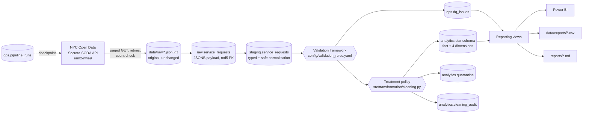
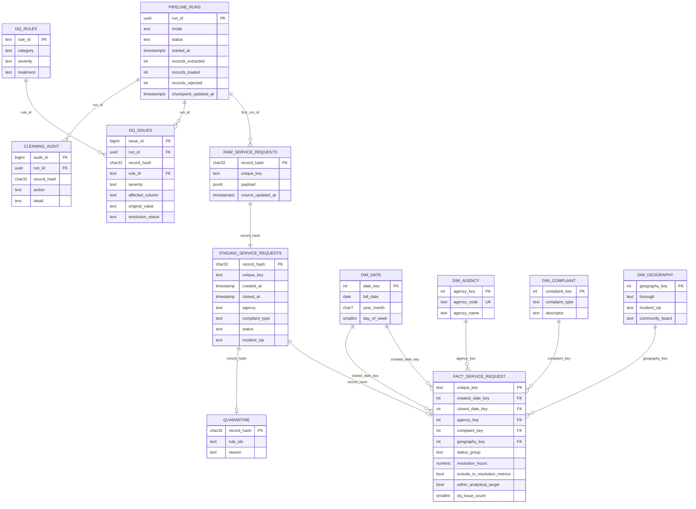

# Architecture

## Data flow

## Layers

| Layer | Schema | Contents | Rule |
|---|---|---|---|
| Raw | `raw` | API records as JSONB, hash-keyed | Append-only; never modified. Old versions are kept as history. |
| Staging | `staging` | One typed row per raw row, plus original timestamp text | Only safe normalisation (trim, upper-case codes, ISO parse, 5-digit ZIP) |
| Ops | `ops` | Run history, rule catalogue, issues | One issue row per (run, record, rule, column) |
| Analytics | `analytics` | Star schema, quarantine, audit, views | Latest valid version per `unique_key` |

## Run modes

| Command | What it does |
|---|---|
| `--full-refresh` | Extracts the whole configured window, loads raw/staging, validates all staging rows in the window, rebuilds analytics |
| `--incremental` | Extracts records whose Socrata `:updated_at` is later than the last checkpoint minus a 2-day overlap, then does the same validation and publishing |
| `--validate-only` | Re-runs validation on staging and writes issues for a new run id; analytics untouched |
| `--generate-reports` | Rebuilds views, CSV exports, markdown reports and `reports/metrics.json` |

## Reliability design

* **Atomic raw file.** Pages stream to `*.part`, which is renamed only after the extracted row count is at least the
  API's own `count(*)`. A failed extract deletes the partial file and never replaces a good one.
* **Single transaction** covers raw insert, staging, issues, dimensions, fact upsert, quarantine and audit. Any
  exception rolls all of it back, and the run is recorded as `failed` with its error message.
* **No empty publish.** A full refresh that returns zero rows, or cleaning that leaves zero rows, is refused, so the
  dashboard can't show misleading zero metrics.
* **Idempotency.** Raw/staging use `ON CONFLICT (record_hash) DO NOTHING`. The fact table is upserted on
  `unique_key`, and keys no longer publishable are removed. Re-running a mode gives the same analytics state
  (verified by `tests/test_integration_pipeline.py` and by the incremental run on real data: 5,170 overlap rows
  re-read, 0 new raw rows).
* **Checkpoints.** `ops.pipeline_runs.checkpoint_updated_at` stores the maximum Socrata `:updated_at` seen. Retries
  are safe because of the overlap window and hash dedup.
* **Retries.** Exponential backoff on network errors, HTTP 429 and 5xx. Other 4xx errors fail immediately. During
  the real extraction two HTTP 503 responses were retried successfully.

## ER diagram (analytics, ops and staging)

## Why these technologies

* **PostgreSQL**: transactions, `ON CONFLICT` upserts, JSONB for unchanged raw payloads, `percentile_cont`, and a
  native Power BI connector. It runs locally in Docker.
* **Python + pandas**: the validation rules are clearer and easier to unit-test as DataFrame masks than as
  hundreds of lines of SQL. At 134k rows everything fits comfortably in memory.
* **COPY via psycopg3**: loads 134k rows in seconds inside the same transaction as the rest of the run.
* **Power BI**: the target BI tool for the roles this project is aimed at. The views keep business logic in SQL, so
  the DAX stays thin.
